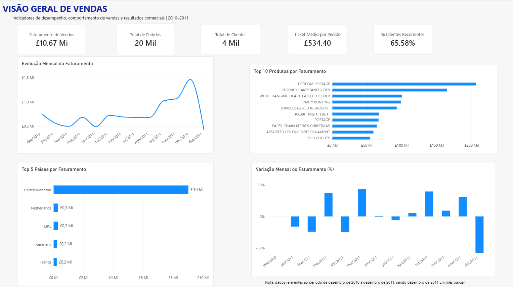
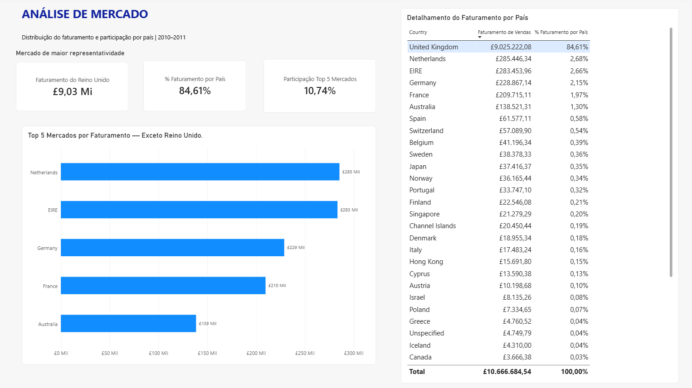

# Análise de Vendas — Online Retail

Projeto de análise de dados comerciais desenvolvido com Power BI, com o objetivo de identificar padrões de vendas, acompanhar indicadores de desempenho e analisar a participação dos mercados nas vendas de uma loja online.

## Objetivo

Desenvolver uma análise a partir de transações comerciais de uma loja online do Reino Unido, explorando informações sobre faturamento, pedidos, clientes e desempenho por país.

O projeto busca transformar dados transacionais em informações visuais que apoiem a interpretação dos resultados e a tomada de decisões.

## Fonte de dados

- **Dataset:** Online Retail
- **Fonte:** UCI Machine Learning Repository
- **Link:** https://archive.ics.uci.edu/dataset/352/online+retail
- **Período analisado:** Dezembro de 2010 a dezembro de 2011
- **Volume original:** 541.909 registros
- **Moeda:** Libra esterlina (£)

A base contém informações sobre pedidos, produtos, quantidades, preços, datas das transações, clientes e países.

## Ferramentas e tecnologias

| Ferramenta | Aplicação |
|---|---|
| Power BI | Construção dos dashboards e visualização dos indicadores |
| Power Query | Tratamento e preparação dos dados |
| DAX | Criação de medidas e indicadores |
| Excel | Arquivo de origem dos dados |
| SQL | Consultas e análises complementares planejadas |

## Etapas do projeto

### 1. Exploração dos dados

- Importação da base Online Retail.
- Análise da estrutura e dos campos disponíveis.
- Identificação de valores ausentes, quantidades negativas e registros de cancelamento.

### 2. Tratamento dos dados

- Ajuste dos tipos de dados.
- Conversão de campos de data, valores numéricos e identificadores.
- Criação da coluna de receita a partir da quantidade e do preço unitário.
- Investigação de inconsistências e particularidades da base.

### 3. Modelagem e indicadores

Criação de medidas em DAX para acompanhar indicadores como:

- Faturamento total.
- Quantidade vendida.
- Total de pedidos.
- Total de clientes.
- Ticket médio por pedido.
- Clientes recorrentes.
- Variação mensal do faturamento.
- Participação do faturamento por país.

### 4. Desenvolvimento dos dashboards

**Visão Geral de Vendas**

Apresenta os principais indicadores comerciais, a evolução mensal do faturamento e o desempenho dos países.

**Análise de Mercado**

Explora a participação dos países no faturamento, destacando o mercado do Reino Unido e comparando os demais mercados.

## Principais observações

- O Reino Unido representa a maior participação no faturamento da base analisada.
- O dashboard de análise de mercado permite observar a distribuição das vendas entre os demais países.
- A análise temporal permite acompanhar a evolução do faturamento ao longo do período.

## Dashboards

### Visão Geral de Vendas



### Análise de Mercado




## Estrutura do repositório

```text
analise-vendas-online-retail/
├── README.md
├── dashboard/
│   └── Analise_de_Vendas.pbix
├── assets/
│   ├── dashboard-visao-geral.png
│   └── dashboard-analise-mercado.png
├── dados/
│   └── README.md
├── sql/
│   └── consultas.sql
└── documentacao/
    └── metodologia.md
```
## Próximas etapas

- Desenvolver consultas SQL para aprofundar as análises.
- Documentar as decisões de tratamento dos dados.
- Ampliar a análise exploratória.
- Registrar novos insights identificados durante o desenvolvimento.

## Autoria

**Isabella Vitória**

Formada em Análise e Desenvolvimento de Sistemas, com interesse em Análise de Dados e Business Intelligence.

- [LinkedIn](https://www.linkedin.com/in/isabella-vit%C3%B3ria-ads)
- [GitHub](https://github.com/Isah2525)

---

Projeto desenvolvido para fins de estudo e portfólio profissional.
